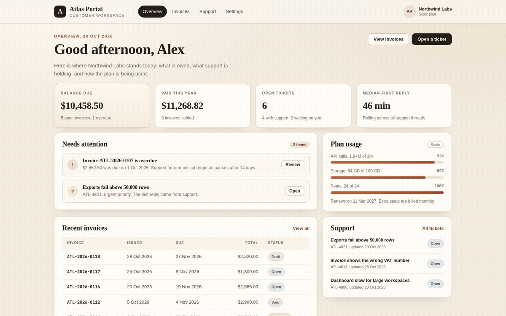
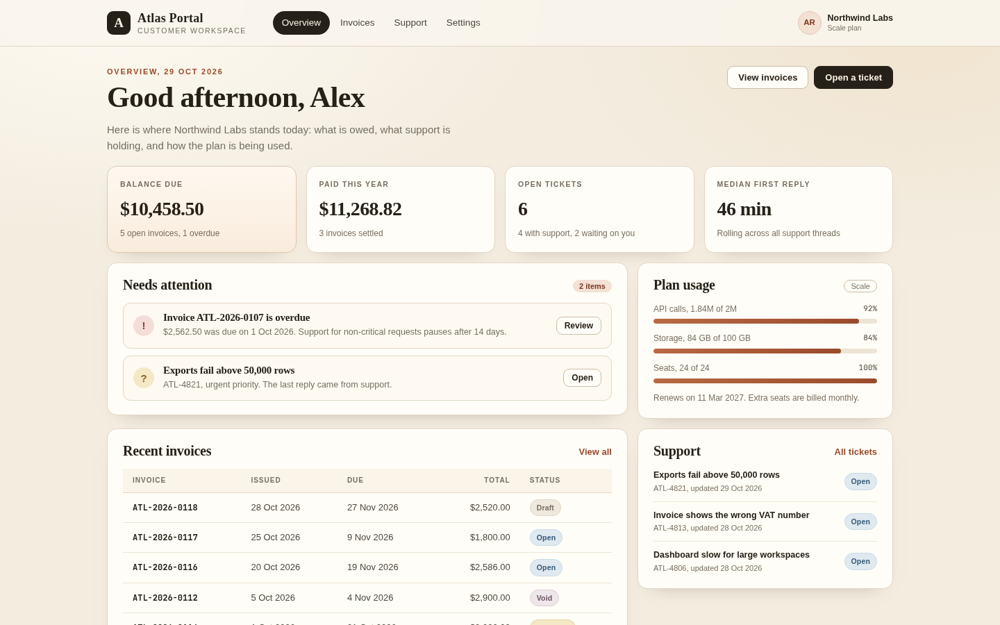
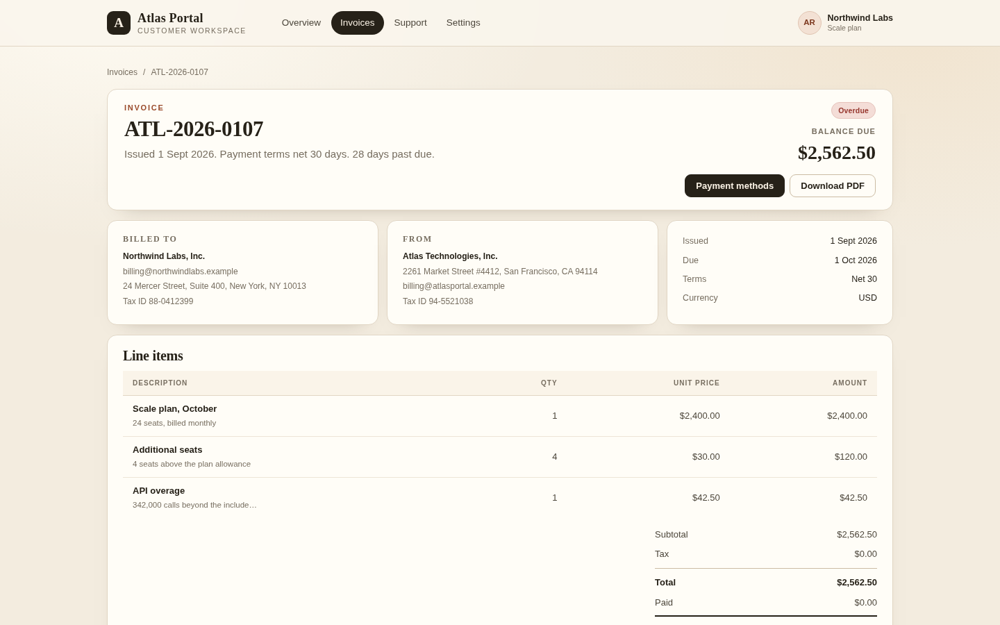

<div align="center">

</div>

<sub>Recorded from the live demo, <a href="docs/demo.mp4">MP4</a> · <a href="docs/screenshot.png">static frame</a></sub>

# Atlas Portal

A customer portal built as a real Next.js 15 application. Customers see a server-rendered dashboard, their invoices and balances, support threads they can reply to, and account settings. The data layer is typed TypeScript with pure selectors, the App Router uses server components for the page work, and two route handlers expose the same numbers as JSON.

[**Open the live demo**](https://arvion-technology.github.io/labs/demos/atlas-portal/) · [MIT](LICENSE)

---

The demo is the static export of this application. `npm run build` writes `out/`, `npm run prepare-demo` rewrites that build into `demo/` with relative asset paths, and a small vanilla `demo/app.js` mirrors the filtering and ticket reply interactions because the gallery has no Next server. The application in `app/`, `components/` and `lib/` is the part worth reviewing; `demo/` is generated output you can open without a server.

## What it does

- **Dashboard** with server-rendered metrics: balance due, paid this year, open tickets and median first reply. The metrics render inside a Suspense boundary so the shell can stream before the numbers resolve.
- **Invoices**: a filterable list with derived status, a detail page with line items, tax, payments and balance, and a printable layout that reads like a paper invoice.
- **Support tickets**: a filterable queue and a reply thread with the conversation record, priority, tags and response target. Replies work in the browser demo; the real app would post them to an API.
- **Settings**: workspace and billing details, API key reveal, notification preferences, team roles, and the static developer endpoints.
- **Typed route handlers** at `/api/summary` and `/api/invoices`, resolved at build time for the static export.

## Screenshots





## Architecture

```text
app/
  layout.tsx                 paper theme, header, footer
  page.tsx                   dashboard, async metrics in Suspense
  invoices/page.tsx          invoice list
  invoices/[id]/page.tsx     invoice detail, generateStaticParams
  tickets/page.tsx           ticket list
  tickets/[id]/page.tsx      ticket thread
  settings/page.tsx          account settings
  api/summary/route.ts       GET, force-static
  api/invoices/route.ts      GET, force-static
components/
  InvoiceExplorer.tsx        "use client" filters and table
  TicketExplorer.tsx         "use client" filters and queue
  TicketThread.tsx           "use client" reply thread
  SettingsForm.tsx           "use client" settings form
lib/
  data.ts                    sample workspace, pinned portal clock
  types.ts                   invoice, ticket, account models
  selectors.ts               totals, derived status, filters, metrics
  format.ts                  money, dates, initials
test/                        25 node:test cases over lib/
scripts/
  prepare-demo.mjs           out/ to demo/ with relative paths
  mirror-app.js              vanilla interaction mirror copied to demo
```

The demo never imports framework code. It is the server-rendered HTML from the export plus the mirror script, which is why it can sit on GitHub Pages with no Node process.

## Quickstart

```bash
npm ci
npm run dev        # http://localhost:3000
npm test           # 25 tests, no browser required
npm run build      # static export into out/
npm run prepare-demo
npm run demo       # serves the exported demo on http://localhost:4173
```

`npm ci` installs from the committed `package-lock.json`. Node 22 or newer is required because the tests import TypeScript directly using Node's built-in type stripping. There is no test framework dependency.

To rebuild the gallery copy after a change:

```bash
npm run build && npm run prepare-demo
```

## How it works

**Server components own the page, client components own the controls.** `/`, the invoice pages and the ticket detail header render on the server from `lib/data.ts`. Filtering is interactive, so `InvoiceExplorer` and `TicketExplorer` are client components that receive plain serializable rows and run the same pure selectors in the browser. The ticket reply box is a client component with local state; nothing in the demo pretends a reply was saved on a server.

**Invoice status is derived, never stored.** Only the issue date, due date, lines, tax rate and payments are facts. `invoiceTotalMinor()` sums integer minor units, applies tax once, and `deriveInvoiceStatus()` applies the order void, draft, paid, partial, overdue, open against an injected portal date. The balance is the total minus payments, clamped at zero. That is why the dashboard, the list, the detail page and `/api/invoices` cannot disagree.

**The static export is a deployment target, not a second implementation.** `next.config.mjs` sets `output: "export"` and `trailingSlash: true`. `generateStaticParams` enumerates every invoice and ticket id so the detail routes exist as files. The route handlers declare `dynamic = "force-static"` because a statically exported site has no request-time server to call.

**The demo pipeline is explicit.** `scripts/prepare-demo.mjs` copies `out/` into `demo/`, removes the hydration scripts, rewrites absolute `/_next/` URLs, converts internal links to relative paths and adds a `<base>` tag per page so nested routes resolve assets from the demo root. A fixed banner points back to the gallery. If you change a page, rebuild and rerun the script; do not edit `demo/` by hand.

**Money and dates are boring on purpose.** Amounts are integer cents formatted with `Intl.NumberFormat`, dates are `YYYY-MM-DD` keys compared as strings, and no floating point value ever reaches a total. The sample workspace in `lib/data.ts` is deliberately static: the portal clock is pinned to 29 October 2026 so the overdue invoice stays overdue in screenshots and tests.

## Tests

```bash
npm test
```

25 tests on `node:test` cover the data layer without booting Next:

- invoice subtotals, tax rounding, paid and due amounts;
- derived status boundaries, including "due today is still open";
- summary totals with drafts and voids excluded;
- invoice and ticket filters, sort order and lookups;
- first response time, median response, status counts and latest message;
- money and date formatting, leap and month boundaries, display helpers;
- seed data integrity: unique ids, positive totals, every invoice state present.

CI runs the same suite, then the production build. The workflow uses Node 22, `npm ci`, `npm test` and `npm run build`.

## Limitations

- There is no authentication, database or live backend. The portal is a reference implementation with a fixed sample workspace, and nothing you change in the demo is saved beyond the browser session.
- The reply composer and settings form update local state only. A production version would add authenticated POST handlers, optimistic updates, and server-side persistence.
- The static export removes client hydration from `demo/` on purpose. Interactions there are a deliberately small mirror, not a second React app, so the gallery stays build-free.
- Route handlers are read-only and resolved at build time. They demonstrate the data contract; they are not a public API.
- PDF download and payment links are visual placeholders. Invoice payment is recorded in the sample data, not charged.

## Project layout

```text
atlas-portal/
├── app/                    App Router pages, layout and route handlers
├── components/             server and client components
├── lib/                    types, sample data, selectors, formatting
├── test/                   25 node:test cases
├── demo/                   generated static export for the gallery
├── docs/                   screenshots and recorded demo
├── scripts/                export prep, mirror script, serve, shot
├── next.config.mjs         output: "export"
├── package-lock.json       npm ci lockfile
└── .github/workflows/      Node 22 CI: ci, test, build
```

## Credits

Built by [Arvion Technologies](https://arviontech.net) in Kathmandu as part of our open-source [Labs](https://github.com/arvion-technology/labs) series. MIT licensed.
